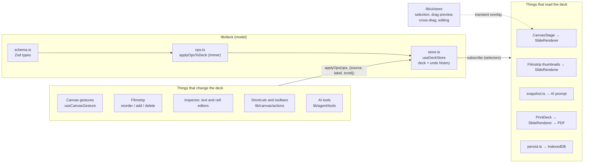

# AI Presentation Builder — Architecture

A single-page Next.js app for generating and editing 16:9 slide decks. An AI agent (Sarvam chat completions with tool calling) creates and edits slides, and a free-form canvas editor lets the user do the same by hand. Both go through the same typed operations on one deck store, so every change, whether from a person or the AI, can be undone, is saved, and shows up the same way.

- [1. Folder guide](#1-folder-guide)
- [2. Architecture overview](#2-architecture-overview)
- [3. Drag-and-drop and cross-slide moves](#3-drag-and-drop-and-cross-slide-moves)

---

## 1. Folder guide

```text
.
├── src/
│   ├── app/            Next.js App Router: the page, global CSS, two API routes
│   ├── components/     React UI, grouped by editor region
│   └── lib/            State, domain logic, AI agent, server helpers (no JSX)
├── docs/superpowers/   Design spec and the stage-by-stage implementation plans
├── public/             Static assets (favicon)
├── spec.md             The original assignment brief
└── (config)            package.json, tsconfig.json, next.config.ts, postcss.config.mjs, .oxlintrc.json, .env.example
```

### Root files

| File | Purpose |
|---|---|
| `package.json` | Scripts (`dev`, `build`, `start`, `lint` with oxlint, `typecheck`) and dependencies: Next 16, React 19, Zustand, Immer, Zod 4, Recharts, dnd-kit, Tailwind 4. |
| `.env.example` | `SARVAM_API_KEY` and `SARVAM_MODEL` (default `sarvam-105b`). Copy it to `.env.local`. |
| `next.config.ts`, `postcss.config.mjs`, `tsconfig.json`, `.oxlintrc.json` | Tooling config. `@/*` resolves to `src/*`. |
| `AGENTS.md` | Notes for coding agents (this Next.js version differs from older ones; read `node_modules/next/dist/docs/`). |
| `spec.md` | The assignment this app implements. |
| `docs/superpowers/specs/` | The design document (data model, agent design, roadmap). |
| `docs/superpowers/plans/` | One plan per build stage: schema/store/render, canvas manipulation, slide operations, AI edit mode, AI generation, content editing, cross-slide drag-and-drop, persistence/export, and a design-review refactor. |

### `src/app/` — routes

| Path | Purpose |
|---|---|
| `layout.tsx` | Root HTML layout and metadata. |
| `page.tsx` | The only page. Renders `EditorShell` inside `ClientOnly` and `Suspense`, because the editor depends on browser APIs such as IndexedDB and `ResizeObserver`. |
| `globals.css` | Tailwind import, theme tokens (`accent`, `chrome-border`), AI pulse and shimmer animations, and the `@media print` rules that make each slide one 1600×900 page. |
| `api/chat/route.ts` | `POST /api/chat`. Checks the body size, rate-limits per client, validates the request with `ChatRequestSchema`, adds the system prompt and tools for the requested mode, calls Sarvam, and streams the SSE response straight back. Holds the API key so the browser never sees it. |
| `api/image/route.ts` | `GET /api/image?q=keyword`. Searches Wikimedia Commons for a photo and replies with a 302 redirect to it. Falls back to a seeded picsum.photos image. The AI's image elements use this URL as their `src`. |

### `src/lib/` — state and logic

#### `lib/deck/` — the document model (the core of the app)

| File | Purpose |
|---|---|
| `schema.ts` | Zod schemas and inferred types for `Deck`, `Slide`, `Element` (a discriminated union of `text`, `image`, `chart`, `table`, `shape`), `Box`, and each payload type. The deck is normalized: `slideOrder` plus a `slides` map, and an `elements` map where each slide lists its `elementOrder` (array order is z-order). `nextId` produces short ids such as `s3` and `e12`. |
| `ops.ts` | The **only way to change a deck.** `Op` is a union of 11 operations: `update_deck`, `add_slide`, `update_slide`, `delete_slide`, `reorder_slides`, `duplicate_slide`, `add_element`, `update_element`, `move_element`, `delete_element`, `reorder_element`. `applyOpsToDeck` runs a batch inside Immer's `produceWithPatches`, validates each op, clamps boxes, and returns per-op results plus forward and inverse patches. |
| `store.ts` | `useDeckStore` (Zustand): `deck`, `past`, `future`, `applyOps(ops, meta)`, `undo`, `redo`, `replaceDeck`. |
| `history.ts` | Turns patches into undo transactions (`Txn`). Calls that share a `txnId` merge into one entry, which is how one AI reply or a burst of arrow-key nudges undoes in a single step. Keeps at most 100 entries. |
| `elements.ts` | A per-element-type registry: how to describe it to the AI, how to merge a patch into it, and what double-click does (edit text, edit a cell, open the inspector, or nothing). |
| `geometry.ts` | `isFiniteBox` and `clampBox`, which keep elements on the 1600×900 artboard with a minimum size. |
| `constants.ts` | Artboard size (1600×900), minimum element size, chart palette. |
| `persist.ts` | IndexedDB load and autosave. On startup it loads the saved deck and validates it with `DeckSchema`; if validation fails, the raw copy is kept under a backup key. After that, every deck change is saved 300 ms after the last edit. |
#### `lib/ui/` — transient editor state

| File | Purpose |
|---|---|
| `store.ts` | `useUiStore`: current slide, selection, live drag preview, cross-slide drag state, marquee, filmstrip drag, rename and edit sessions, right-panel tab, AI highlight pulses. None of this is saved or undoable. It also subscribes to the deck store so that when the current slide is deleted, the view moves to a neighbouring slide. |
| `useCurrentSlideId.ts`, `useSelectedIds.ts` | Hooks that resolve the stored ids against the live deck, so they never point at deleted slides or elements. |

#### `lib/canvas/` — canvas math and actions

| File | Purpose |
|---|---|
| `geometry.ts` | Box helpers: translate, union, intersect, marquee rectangle, `clampGroupDelta` (keeps a multi-selection on the artboard). |
| `snap.ts` | Snapping to the artboard and other elements' edges and centers, and the guide lines to draw. |
| `resize.ts` | Eight resize handles; `resizeBox` with optional aspect-ratio lock. |
| `actions.ts` | Selection commands used by shortcuts and toolbars: delete, duplicate, nudge (merged into one undo entry), z-order, select all, and `moveElementsToSlide`. |

#### `lib/slides/actions.ts`

Slide-level commands: add a blank slide, duplicate, delete, rename, `moveSlide` (reorder), start a new deck (undoable).

#### `lib/content/` — manual content editing

| File | Purpose |
|---|---|
| `actions.ts` | Start an edit session (text, table cell, or inspector), commit text, commit a cell, add or remove rows and columns, replace an image. |
| `insert.ts` | Default elements for the insert toolbar and placement of new elements. |
| `chartData.ts`, `tableData.ts` | Pure helpers for editing chart series and categories, and table rows and columns. |
| `image.ts` | Reads an uploaded file into a data URL along with its natural size. |

#### `lib/agent/` — the AI agent (runs in the browser)

| File | Purpose |
|---|---|
| `sendPrompt.ts` | Entry point from the chat box: an empty deck goes to `generateDeck`, otherwise to `runAgent`. |
| `generateDeck.ts` | Generation. A **plan** call streams a `plan_deck` tool call; slides appear as each outline entry arrives in the stream. Then each slide is **populated** in parallel (two at a time). Also handles clarifying questions and "Fill with AI" retries. |
| `populateSlide.ts` | Fills one planned slide with a short loop of tool calls that may only touch that slide, then lays it out neatly with `arrange.ts`. |
| `runAgent.ts` | The **edit** loop. Each step sends the conversation and a fresh deck snapshot, executes the streamed tool calls, feeds the results back, and stops when the model replies without tools (at most 12 steps). The whole reply shares one `txnId`, so it undoes in one step. |
| `executeTool.ts` | Finds a tool, parses its JSON arguments, enforces scope (populate may only change its own slide; elements the user is editing are off limits), runs it, and builds the tool-result message. `aiToolContext` connects tools to `applyOps` with `source: "ai"`. |
| `tools/` | Tool definitions. Each is a Zod argument schema plus a `run` that produces `Op`s. `slideTools`, `elementTools`, `chartTableTools`, and `planTool` (`plan_deck`). `index.ts` picks the tools for each mode and converts them to OpenAI JSON Schema. |
| `snapshot.ts` | Converts the deck into the compact text the model reads (slide ids, element ids, boxes, content, and what changed earlier in this reply). |
| `protocol.ts` | The client–server contract: `ChatRequestSchema`, message and tool-call shapes, and limits. |
| `agentRequest.ts`, `sse.ts` | `fetch("/api/chat")`, the SSE reader, and an accumulator that rebuilds text and tool calls from streamed deltas. Also turns errors into user-facing messages. |
| `toolCallTags.ts` | Recovers tool calls that the model wrote as `<tool_call>` tags in its text instead of as structured calls. |
| `placement.ts`, `arrange.ts` | Default positions and text styles, plus a layout-aware tidy-up of a slide's body elements. |
| `reveal.ts` | After an AI change: pulse the touched elements and thumbnails, and go to that slide unless the user is busy (dragging, editing, or renaming). |

#### Other `lib/` stores and server code

| Path | Purpose |
|---|---|
| `lib/chat/store.ts` | Chat transcript items, the model-facing history (last 6 messages), the clarifying-question thread, recent AI change summaries, and the abort controller for the running turn. |
| `lib/generation/store.ts` | Generation progress: the planned outline per slide, per-slide fill status (pending, filling, done, failed, stopped), and the title of the next slide while outlining. |
| `lib/server/sarvam.ts` | Builds the completion body for each mode (system prompt, tools, `tool_choice`, model, token limit) and calls Sarvam. |
| `lib/server/prompts.ts` | System prompts for edit, plan, and populate. |
| `lib/server/rateLimit.ts` | In-memory per-IP limit: 40 requests per minute, 400 per day. |

### `src/components/` — UI

| Folder | Contents |
|---|---|
| `shell/` | `EditorShell` (the three-column layout, header, undo/redo, export; waits for `restoreDeck()`), `RightPanel` (Chat and Format tabs), `SelectionToolbar` (z-order, **Move to…**, duplicate, delete), `PrintDeck` (PDF export), `useEditorShortcuts` (global keyboard shortcuts), `ClientOnly`. |
| `slide/` | Rendering shared by the canvas, thumbnails, the drag ghost, and print. `SlideRenderer` draws a slide's elements in z-order at artboard coordinates. `ScaledArtboard` scales the 1600×900 artboard with a CSS transform and exposes `--artboard-scale`. `elements/` has one view per element type (`TextView`, `ImageView`, `ChartView` using Recharts, `TableView`, `ShapeView`), chosen by `ElementView`. |
| `canvas/` | The interactive editor for the current slide. `CanvasStage` combines `ArtboardViewport` (fit-to-window scaling), `SlideRenderer`, and the overlays. `useCanvasGesture` handles move, resize, marquee, and cross-slide drag. `SelectionOverlay` draws handles and snap guides. `CrossSlideGhost` is the floating preview during a cross-slide drag. `TextEditor` and `TableCellEditor` are the in-place editors. `AiHighlightOverlay` and `SlideFillOverlay` show AI activity. |
| `filmstrip/` | The left sidebar. `Filmstrip` is a dnd-kit sortable list. `SlideThumbnail` is a sortable item and also a cross-slide drop target. `SlideTitle` supports inline rename. `FilmstripToolbar` has the add, duplicate, and delete buttons. `FillBadge` shows per-slide generation status. |
| `chat/` | `ChatPanel`, `ChatTranscript` (user and assistant messages, tool summaries, notices with retry, generation progress), `ChatComposer` (prompt box with stop button). |
| `inspector/` | The Format tab: a per-type inspector (`TextInspector`, `ImageInspector`, `ChartInspector`, `TableInspector`) and shared form fields. |
| `insert/` | `InsertToolbar` above the canvas (text, shapes, chart, table, image) and `ImagePickerButton`. |
| `generation/` | Empty-deck prompt screen, planning skeleton, generation progress card. |

---

## 2. Architecture overview

### Layers



There are three rules behind this structure:

1. **The schema defines the document.** `DeckSchema` checks decks loaded from IndexedDB, and the same Zod definitions are used for tool arguments and API requests. Everything else uses the inferred TypeScript types.
2. **Every change is an `Op`.** Canvas gestures, keyboard shortcuts, the inspector, the filmstrip, and AI tools all call `useDeckStore.getState().applyOps(ops, meta)`. Nothing else writes to the deck. That is why undo, autosave, AI pulses, and the AI's view of the deck work the same no matter who made the change.
3. **Persistent state and transient state are separate.** `useDeckStore` holds the document and its history. `useUiStore` holds what is happening right now (selection, the drag in progress, edit sessions). A drag updates only the UI store until the pointer is released, so a drag creates exactly one undo entry.

### Data flow, step by step

**Schema → store.** `applyOpsToDeck(deck, ops)` runs every op in the batch against an Immer draft. Each op returns `{ ok, id? }` or `{ ok: false, error }`; a failed op leaves the draft unchanged and the rest still run. The store saves the new deck and records a `Txn` from the patches (merging into the previous one when `txnId` matches). Undo and redo apply the stored patches. They never re-run ops.

**Store → canvas.** `CanvasStage` renders `SlideRenderer` for the current slide inside `ArtboardViewport`, which scales the fixed 1600×900 coordinate space to fit the window. All element positions are in artboard units; only the outer wrapper is scaled. During a gesture, `SlideRenderer` receives `previewBoxes` from `useUiStore.dragPreview` and draws those positions instead of the stored ones. Overlays (selection handles, snap guides, editors, AI highlights) sit on top in the same coordinate space and use `--artboard-scale` to keep line widths constant on screen.

**Store → filmstrip.** Each `SlideThumbnail` renders the same `SlideRenderer` with `variant="thumbnail"` inside a `ScaledArtboard` at 168/1600 scale. Zustand selectors with `useShallow` plus memoized element views mean that only the slides whose elements changed re-render.

**Chat tools → store.** The browser runs the agent loop; the server only relays requests:


- **Plan mode** (empty deck): only `plan_deck` is available. Slides are added as the outline streams in, before the call finishes.
- **Populate mode** (one call per planned slide): the six content tools are available (`add_element`, `update_element`, `add_chart`, `update_chart_data`, `add_table`, `update_table`), and `tool_choice` is `"required"`. `executeTool` rejects any change outside the target slide.
- **Edit mode**: all 17 slide, element, chart, and table tools.

Every AI change in one reply shares one `txnId`, so ⌘Z undoes the entire reply. Because the AI reads a fresh snapshot on every step, it always sees manual edits the user made in the meantime. If the user is editing an element, tool calls that target it fail with a message telling the model to leave it alone.

**Store → export.** "Export PDF" (or ⌘P) sets `printing`, and `PrintDeck` portals one `SlideRenderer variant="print"` per slide into `document.body`. It waits for fonts and images to load, then calls `window.print()`. The print CSS sets `@page { size: 1600px 900px; margin: 0 }`, hides the editor, and puts a page break after each slide, so "Save as PDF" in the print dialog gives one page per slide. The exported slides use the same renderer as the canvas, so they look the same.

**Store → persistence.** `restoreDeck()` runs once, before the editor first renders (via React's `use()`). It loads and validates the saved deck, then starts the debounced autosave subscription. Undo history is not saved.

---

## 3. Drag-and-drop and cross-slide moves

The app uses two separate drag systems, chosen to fit each job:

| Interaction | Implementation | Why |
|---|---|---|
| Reordering slides in the filmstrip | `@dnd-kit/sortable` | A vertical sortable list is exactly what dnd-kit does well, including the drag overlay and accessibility announcements. |
| Moving, resizing, and marquee-selecting elements on the canvas, and dragging elements onto another slide | Custom pointer events in `useCanvasGesture` | It needs coordinates that account for the canvas scale, snapping to other elements, resize handles, axis locking, and a single undo entry per drag. A list-oriented library doesn't help with that. |

The two systems never conflict. Canvas drags use pointer capture on the stage, and they find drop targets by hit-testing the DOM rather than registering dnd-kit droppables.

### 3.1 Moving elements within a slide

All of this lives in `src/components/canvas/useCanvasGesture.ts`, attached to the artboard `div` in `CanvasStage`.

1. **Pointer down.** The hook reads `data-handle`, `data-element-id`, or neither from the event target and starts one of three gestures: `resize` (a handle on a single selected element), `move` (an element; the whole selection moves if the element was already selected), or `marquee` (empty space). It calls `setPointerCapture`, so the stage keeps receiving pointer events even after the pointer leaves it, including over the filmstrip. The scale is `rect.width / 1600`, and every pointer position is converted to artboard units with it.
2. **Pointer move.** Nothing happens until the pointer has moved 3 screen pixels, so a click doesn't nudge anything. After that, the group's bounding box is translated by the pointer delta. Then:
   - Shift locks movement to the dominant axis.
   - Snapping (`snapMove`) pulls the group to the edges and centers of the artboard and of other elements within 6 screen pixels. Holding ⌘ or Ctrl turns snapping off.
   - `clampGroupDelta` keeps the whole group on the artboard.
   - The resulting boxes and guide lines go into `useUiStore.setDragPreview`. **The deck is not touched.** `SlideRenderer` draws the preview boxes, and `SelectionOverlay` draws the guides.
3. **Pointer up.** For each element whose preview box differs from its starting box, a `move_element` op is created, and they are all applied in one `applyOps` call labelled "Move element" or "Move N elements", which is one undo entry. Resize works the same way and commits a single `update_element` box patch.
4. **Escape** (handled by a capture-phase `keydown` listener) cancels the gesture and drops the preview. For a marquee, it also restores the selection from before the drag.

Keyboard nudging (arrow keys, Shift+arrow for 20 units) goes through `nudgeSelection`. Nudges less than 800 ms apart share a `txnId`, so a burst of presses undoes as one step.

### 3.2 Dragging elements onto another slide

A cross-slide move is a continuation of the canvas move gesture. There is no separate drag source.

```mermaid
sequenceDiagram
  participant P as Pointer (captured by stage)
  participant G as useCanvasGesture
  participant UI as useUiStore
  participant Ghost as CrossSlideGhost
  participant Th as SlideThumbnail
  participant D as useDeckStore

  P->>G: move inside the artboard
  G->>UI: setDragPreview(boxes) (normal move)
  P->>G: move outside the artboard rect
  G->>UI: setDragPreview(null), setCrossDrag({ids, group, left, top, targetSlideId, copy})
  UI-->>Ghost: render the floating preview at (left, top)
  UI-->>Th: thumbnail where targetSlideId matches shows a drop ring
  P->>G: pointer up
  alt over a thumbnail
    G->>D: moveElementsToSlide(ids, target, altKey) → move_element {toSlideId, copy}
    G->>UI: goToSlide(target), select the moved elements
  else anywhere else
    G->>UI: clear; nothing changes
  end
```

**Switching modes.** On each pointer move during a `move` gesture, the hook checks whether the pointer is still inside the artboard's bounding rect. When it leaves:

- `dragPreview` is cleared, so the elements reappear at their original positions on the canvas.
- `crossDrag` is set to `{ ids, group, scale, left, top, targetSlideId, copy }`. `left` and `top` are screen coordinates chosen so that the ghost stays under the pointer at the same grab offset.
- The drop target comes from `document.elementFromPoint(x, y)?.closest("[data-drop-slide-id]")`. Each thumbnail button has `data-drop-slide-id={slideId}`. The source slide is ignored, so dropping a selection back onto its own slide does nothing.
- `copy` is `event.altKey`, which can change at any point during the drag.

When the pointer returns to the artboard, `crossDrag` is cleared and the normal move preview resumes.

**Feedback.**

- `CrossSlideGhost` renders the dragged elements with the same `ElementView`s at the canvas scale, offset by the group's origin so they keep their relative layout. Its label reads "Move to slide N", "Copy to slide N", or "Drop on a slide thumbnail". It is portaled to `document.body` because the `transform` on `ScaledArtboard` would otherwise make `position: fixed` relative to the artboard instead of the viewport.
- `SlideThumbnail` subscribes to `crossDrag?.targetSlideId === slideId` and shows an offset accent ring on the target.

**Committing.** On pointer up with a target, `moveElementsToSlide(ids, targetSlideId, copy)` in `lib/canvas/actions.ts` sends one batch of `move_element` ops, labelled for example "Move 2 elements to slide 4". In `ops.ts`, `move_element` with a `toSlideId`:

- **Move:** removes the id from the source slide's `elementOrder`, appends it to the target's (so it lands on top in z-order), and updates `element.slideId`. The element id stays the same.
- **Copy (`copy: true`):** deep-clones the element with `structuredClone`, gives it a new id, and appends it to the target. The original stays where it was.
- The box is kept as is and clamped. Every slide uses the same 1600×900 artboard, so the elements land at the same position they had on the source slide.

Afterwards, the editor goes to the target slide and selects the moved elements by the ids returned in the `OpResult`s. One ⌘Z puts everything back.

**Other ways to do the same thing.** The "Move to…" dropdown in `SelectionToolbar` calls `moveSelectionToSlide`, which uses the same code path. It is the keyboard-accessible option. The AI's `move_element` tool also accepts `toSlideId` and `copy`, and produces the same op.

### 3.3 Reordering slides in the filmstrip

`src/components/filmstrip/Filmstrip.tsx`:

- `DndContext` with a `PointerSensor` that activates after 5 px, so a click still selects a slide, and `closestCenter` collision detection. `SortableContext` uses `deck.slideOrder` as its items, with a vertical list strategy.
- Each `SlideThumbnail` calls `useSortable({ id: slideId })`. The thumbnail button is the drag handle. While a slide is dragged, its own spot shows a dashed placeholder, and the `DragOverlay` (locked to the vertical axis by `restrictToVerticalAxis`) shows the thumbnail with a "Slide N" badge for the drop position.
- `onDragStart` sets `useUiStore.draggingSlideId`. While it is set, the global keyboard shortcuts are ignored and AI changes don't switch slides.
- `onDragEnd` calls `moveSlide(id, overIndex)`, which applies one `reorder_slides` op (one undo entry) and then goes to the moved slide.

Thumbnails show live content because they render the same `SlideRenderer` from the store. Reordering slides, moving elements between slides, and AI edits all appear in the filmstrip immediately, with no separate thumbnail state.
