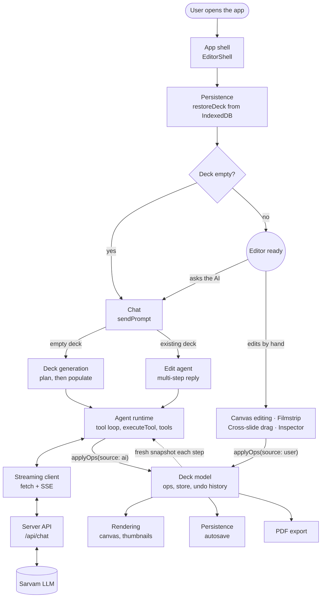
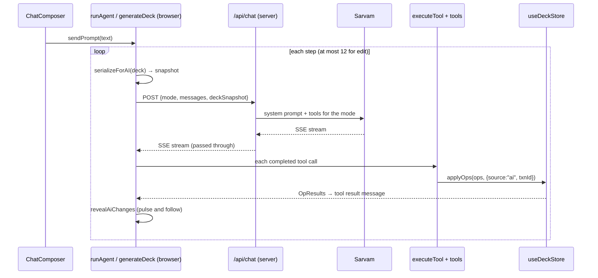
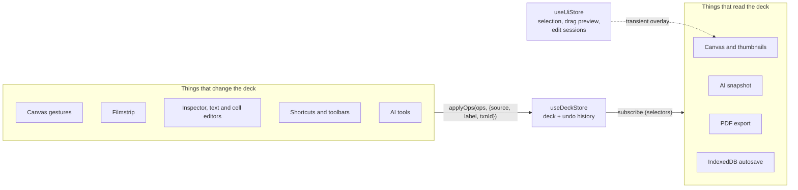

# AI Presentation Builder — Architecture

A single-page Next.js app for generating and editing 16:9 slide decks. An AI agent (Sarvam chat completions with tool calling) creates and edits slides, and a free-form canvas editor lets the user do the same by hand. Both go through the same typed operations on one deck store, so every change, whether from a person or the AI, can be undone, is saved, and shows up the same way.

This page describes the end-to-end flow and links to one document per component in that flow.

- [1. End-to-end flow](#1-end-to-end-flow)
- [2. Components](#2-components)
- [3. Design rules](#3-design-rules)
- [4. Folder guide](#4-folder-guide)

---

## 1. End-to-end flow



The steps, in the order a user meets them:

1. **The app starts.** `page.tsx` loads the [app shell](architecture/app-shell.md) on the client only. It lays out the header, filmstrip, canvas, and right panel, and installs global shortcuts.
2. **The saved deck is restored.** [Persistence](architecture/persistence.md) loads the deck from IndexedDB and validates it before the editor renders, then starts autosaving.
3. **The user types a prompt.** [Chat](architecture/chat.md) takes the prompt and `sendPrompt` routes it: an empty deck goes to generation, anything else to the edit agent. Only one AI turn runs at a time (slide retries during generation join the running one), and Stop aborts it.
4. **Something changes the deck.** One of three paths:
   - a. [Deck generation](architecture/deck-generation.md) plans an outline (slides appear as it streams), then fills each slide in parallel, two at a time.
   - b. The [edit agent](architecture/edit-agent.md) runs a reply of up to 12 tool-calling steps, seeing a fresh snapshot of the deck on each step.
   - c. The user edits by hand: [canvas editing](architecture/canvas-editing.md) (move, resize, insert, text and table editing, inspector), the [filmstrip](architecture/filmstrip.md) (add, delete, rename, reorder slides), or [cross-slide drag](architecture/cross-slide-drag.md) (drop elements onto another slide's thumbnail).
5. **AI tool calls are executed.** The [agent runtime](architecture/agent-runtime.md) streams each step, runs each tool call as soon as it has arrived, enforces scope (populate may only touch its slide; elements the user is editing are off limits), and feeds results back to the model.
6. **Each step is streamed.** The [streaming client](architecture/streaming.md) posts to `/api/chat` and rebuilds text and tool calls from SSE deltas, including tool calls the model wrote as tags in its text.
7. **The server relays to the model.** The [server API](architecture/chat-api.md) checks size, rate limit, and schema, adds the system prompt and tools for the mode, and streams Sarvam's response straight back. It holds the API key and no other state.
8. **Every change becomes ops.** Both the AI and the user call `applyOps` on the [deck model](architecture/deck-model.md). The batch is applied with Immer and recorded as one undo entry, or merged into the previous one when it shares a `txnId`.
9. **The deck is redrawn.** [Rendering](architecture/rendering.md) draws the canvas and every thumbnail with the same `SlideRenderer`, and only slides whose elements changed re-render. AI changes also pulse the touched elements.
10. **The deck is saved and can be exported.** [Persistence](architecture/persistence.md) autosaves 300 ms after the last change, and [PDF export](architecture/pdf-export.md) prints one 1600×900 page per slide.

### One AI edit, end to end



---

## 2. Components

Each component has its own document with its files, how it works, and its edge cases.

| # | Component | Role in the flow | Main code |
|---|---|---|---|
| 1 | [App shell and UI state](architecture/app-shell.md) | Layout, shortcuts, transient editor state | `components/shell/`, `lib/ui/` |
| 2 | [Persistence](architecture/persistence.md) | Restore on startup, autosave | `lib/deck/persist.ts` |
| 3 | [Chat](architecture/chat.md) | Prompt entry, routing, transcript, turn lock | `components/chat/`, `lib/chat/`, `flows/sendPrompt.ts` |
| 4a | [Deck generation](architecture/deck-generation.md) | Empty deck → outline → filled slides | `flows/generateDeck.ts`, `planOutline.ts`, `populateSlide.ts`, `lib/generation/` |
| 4b | [Edit agent](architecture/edit-agent.md) | Multi-step edit reply on an existing deck | `flows/runAgent.ts` |
| 4c | [Canvas editing](architecture/canvas-editing.md) | Manual edits on the current slide | `components/canvas/`, `components/inspector/`, `lib/canvas/`, `lib/content/` |
| 4c | [Filmstrip](architecture/filmstrip.md) | Slide list, slide commands, reorder | `components/filmstrip/`, `lib/slides/` |
| 4c | [Cross-slide drag](architecture/cross-slide-drag.md) | Move or copy elements to another slide | `useCanvasGesture.ts`, `CrossSlideGhost.tsx` |
| 5 | [Agent runtime](architecture/agent-runtime.md) | Tool loop, tool execution, tools, snapshot, layout | `lib/agent/runtime/`, `lib/agent/tools/`, `lib/agent/deck/` |
| 6 | [Streaming client](architecture/streaming.md) | Request, SSE parsing, error messages | `lib/agent/stream/`, `lib/agent/protocol.ts` |
| 7 | [Server API](architecture/chat-api.md) | `/api/chat` relay, prompts, rate limit, `/api/image` | `src/app/api/`, `lib/server/` |
| 8 | [Deck model](architecture/deck-model.md) | Schema, ops, store, undo | `lib/deck/` |
| 9 | [Rendering](architecture/rendering.md) | One renderer for every surface | `components/slide/` |
| 10 | [PDF export](architecture/pdf-export.md) | Print one page per slide | `components/shell/PrintDeck.tsx` |

`lib/agent/` paths above are relative to `src/lib/agent/`: `stream/` talks to `/api/chat`, `deck/` is pure deck logic (no stores), `runtime/` runs tools, `flows/` wires the stores together for the UI, and `tools/` defines the tools. `protocol.ts` stays at the root because the server imports it too.

---

## 3. Design rules



1. **The schema defines the document.** `DeckSchema` checks decks loaded from IndexedDB, and the same Zod definitions are used for tool arguments and API requests. Everything else uses the inferred TypeScript types.
2. **Every change is an `Op`.** Canvas gestures, keyboard shortcuts, the inspector, the filmstrip, and AI tools all call `useDeckStore.getState().applyOps(ops, meta)`. Nothing else writes to the deck. That is why undo, autosave, AI pulses, and the AI's view of the deck work the same no matter who made the change.
3. **Persistent state and transient state are separate.** `useDeckStore` holds the document and its history. `useUiStore` holds what is happening right now (selection, the drag in progress, edit sessions). A drag updates only the UI store until the pointer is released, so a drag creates exactly one undo entry.
4. **The browser runs the agent; the server only relays.** The agent loop, tool execution, and deck snapshots all run in the browser against the live store. `/api/chat` keeps the API key secret and has no deck or conversation state.

---

## 4. Folder guide

```text
.
├── src/
│   ├── app/            Next.js App Router: the page, global CSS, two API routes
│   ├── components/     React UI, grouped by editor region
│   └── lib/            State, domain logic, AI agent, server helpers (no JSX)
├── docs/
│   ├── ARCHITECTURE.md This file
│   ├── architecture/   One document per component
│   └── superpowers/    Design spec and the stage-by-stage implementation plans
├── public/             Static assets (favicon)
├── spec.md             The original assignment brief
└── (config)            package.json, tsconfig.json, next.config.ts, vitest.config.ts, postcss.config.mjs, .oxlintrc.json, .env.example
```

| File | Purpose |
|---|---|
| `package.json` | Scripts (`dev`, `build`, `start`, `lint` with oxlint, `typecheck`, `test` with Vitest) and dependencies: Next 16, React 19, Zustand, Immer, Zod 4, Recharts, dnd-kit, Radix, Tailwind 4. |
| `.env.example` | `SARVAM_API_KEY` and `SARVAM_MODEL` (default `sarvam-105b`). Copy it to `.env.local`. |
| `next.config.ts`, `postcss.config.mjs`, `tsconfig.json`, `.oxlintrc.json`, `vitest.config.ts` | Tooling config. `@/*` resolves to `src/*`. |
| `AGENTS.md` | Notes for coding agents (this Next.js version differs from older ones; read `node_modules/next/dist/docs/`). |
| `spec.md` | The assignment this app implements. |
| `docs/superpowers/specs/` | The design document (data model, agent design, roadmap). |
| `docs/superpowers/plans/` | One plan per build stage: schema/store/render, canvas manipulation, slide operations, AI edit mode, AI generation, content editing, cross-slide drag-and-drop, persistence/export, and a design-review refactor. |

Unit tests (`*.test.ts`) sit next to the code they cover, mostly the pure parts: ops, snapping, snapshot, arrange, plan outcome, tool loop, tool execution, SSE parsing, and rate limiting.
