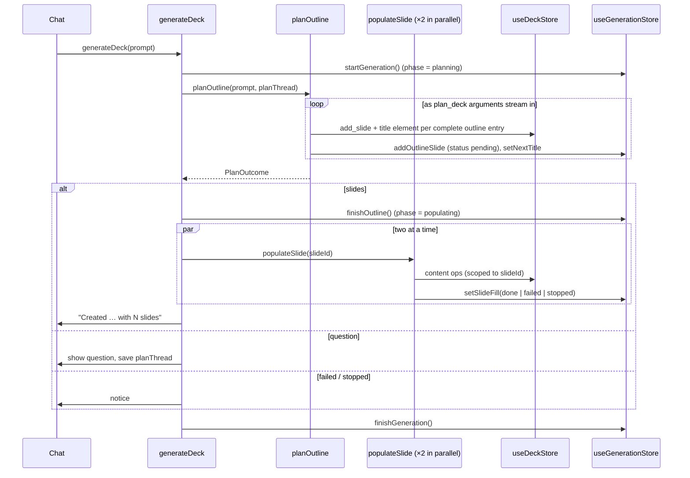

# Deck generation

Turns a prompt into a full deck when the deck is empty: a **plan** call streams an outline onto the canvas, then a **populate** call fills each slide.

[← Back to the architecture overview](../ARCHITECTURE.md)

## Where it sits in the flow

Step 4a of the [end-to-end flow](../ARCHITECTURE.md#1-end-to-end-flow). [Chat](chat.md) calls `generateDeck` when the deck has no slides. Each request goes through [streaming](streaming.md) and the [chat API](chat-api.md); each tool call goes through the [agent runtime](agent-runtime.md) and lands in the [deck model](deck-model.md) as ops.

## Files

| File | Purpose |
|---|---|
| `lib/agent/flows/generateDeck.ts` | Orchestrates one generation: plan, then populate in a pool of two. Also `fillSlide` for retrying one slide. |
| `lib/agent/flows/planOutline.ts` | The plan call. Adds slides to the deck as each outline entry streams in. |
| `lib/agent/flows/planOutcome.ts` | Pure: turns what arrived during planning (`PlanProgress`) into a `PlanOutcome`. Unit-tested. |
| `lib/agent/flows/populateSlide.ts` | Fills one slide using the [tool loop](agent-runtime.md#tool-loop) with tools scoped to that slide. |
| `lib/agent/tools/planTool.ts` | The `plan_deck` tool, `addPlannedSlide`, and `parseStreamedPlan` (reads complete slide objects out of partial JSON). |
| `lib/generation/store.ts` | `useGenerationStore`: phase, the outline per slide, per-slide fill status, and the title of the slide currently streaming. |
| `components/generation/PlanningState.tsx` | Canvas skeleton while the first slide hasn't arrived. |
| `components/generation/GenerationProgress.tsx` | The progress card in the chat transcript, with Retry / Fill per slide. |
| `components/canvas/SlideFillOverlay.tsx`, `components/filmstrip/FillBadge.tsx` | Per-slide fill status on the canvas and the thumbnails. |

## Sequence

## Plan step (`planOutline`)

- **Mode `plan`**: the only tool is `plan_deck` (`{ title, slides: 3–10 × { title, layout, intent, visual } }`). The request carries no deck snapshot.
- **Slides appear while streaming.** On every argument delta for the first tool call, `parseStreamedPlan` extracts each slide object that has closed. Each new one is added right away with `addPlannedSlide` (an `add_slide` op plus a title text element) and recorded in the generation store with status `pending`. The partially streamed title of the next slide is shown as `nextTitle` in the progress card. At most 10 slides are added.
- **When the full call arrives**, `plan_deck` runs through `executeToolCall` in plan mode. It sets the deck title and appends any slides that hadn't streamed in yet (for example, if the provider sent the arguments in one chunk).
- **Clarifying questions.** If the model replies with text and no slides, the outcome is a question. The exchange is kept in `planThread`, and the next prompt continues that thread. After 3 questions, the request sets `forcePlan`, and the server forces `tool_choice` to `plan_deck`.
`classifyPlan` decides the outcome:

| Outcome | When |
|---|---|
| `slides` | At least one slide arrived and nothing was rejected (a rejection after Stop is ignored). |
| `question` | No slides, some text, and nothing was rejected. |
| `stopped` | No slides and the user pressed Stop. |
| `failed` | The stream failed, part of the outline was rejected, or the reply was truncated or empty. Slides that already streamed in stay on the deck with a Fill button. |

## Populate step (`populateSlide`)

- **Starts early for title slides.** When the first slide arrives and its layout is `title`, its populate call starts immediately while the rest of the outline is still streaming.
- **Concurrency.** The remaining slides go through `runPool` with two workers. Workers stop taking new slides once the signal aborts.
- **Mode `populate`**: six content tools (`add_element`, `update_element`, `add_chart`, `update_chart_data`, `add_table`, `update_table`), with `tool_choice: "required"` on the server. The snapshot (`serializeForPopulate`) lists every slide with its outline intent, marks the target slide, and lists the target's elements.
- **Scope.** Every call runs with `{ mode: "populate", slideId }`, so `executeToolCall` rejects anything aimed at another slide.
- **Loop**, at most 3 steps:
  - After each successful call, `autoArrange` lays out the slide's body elements, and `revealAiChanges` pulses them without switching slides.
  - If every call in a step succeeded, stop. If some failed, continue so the model can see the errors and fix them.
  - If the model made no tool calls, stop.
- **Result.** `done` if the slide has any body element (anything besides the title), otherwise `failed` with the last error. An abort gives `stopped`.

## Undo and retries

The plan and every populate call share one undo group labelled `AI: <prompt>`, so a single ⌘Z removes the generated deck (as long as the user hasn't made an edit in between; see [undo grouping](deck-model.md#undo-history)).

`fillSlide(slideId)` re-runs populate for one slide with its own undo group. It is what the **Retry** and **Fill** buttons call. It needs the slide's outline entry in the generation store, so it only works for slides from the current generation run.

## Generation store

| Field | Meaning |
|---|---|
| `runId` | Increments each generation. The transcript's `generation` item stores its `runId`, so old progress cards show "Generated an earlier deck." |
| `phase` | `idle` → `planning` → `populating` → `done`. |
| `outline` | `PlannedSlide` per slide id, used by populate and by `fillSlide`. |
| `slides` | `SlideFill` per slide id: `pending`, `filling`, `done`, `failed` (with an error), or `stopped`. `finishGeneration` turns any leftover `pending` or `filling` into `stopped`. |
| `nextTitle` | The title of the outline entry currently streaming. |

New deck (`startNewDeck`) calls `resetGeneration()` and clears `planThread`.
