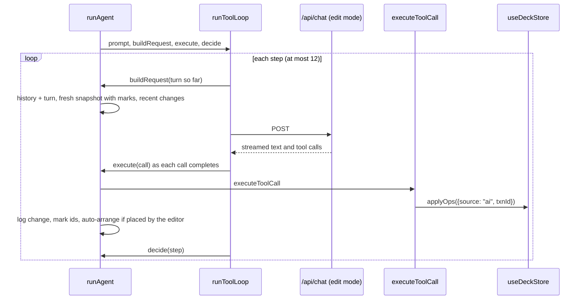

# Edit agent

Handles a chat prompt when the deck already has slides: a multi-step tool-calling reply that edits the deck, sees its own changes, and stops when the request is done.

[← Back to the architecture overview](../ARCHITECTURE.md)

## Where it sits in the flow

Step 4b of the [end-to-end flow](../ARCHITECTURE.md#1-end-to-end-flow). [Chat](chat.md) calls `runAgent` when the deck is not empty. It is built on the [tool loop](agent-runtime.md#tool-loop); requests go through [streaming](streaming.md) and the [chat API](chat-api.md).

## Files

| File | Purpose |
|---|---|
| `lib/agent/flows/runAgent.ts` | `runAgent(prompt)` and `stopAgent()`. |

## How a reply runs

**Each request** (`editRequest`) contains:

- **Messages**: the last 6 model-facing messages from earlier turns (`useChatStore.history`), plus everything in this reply so far: the prompt, each assistant step with its tool calls, and each tool result.
- **A fresh deck snapshot** (`serializeForAI`), taken at the moment of the request. Elements and slides changed earlier in this reply are tagged `(added by you this reply)` or `(edited by you this reply)`. Because it is rebuilt each step, the model also sees edits the user made by hand while it was working.
- **Recent changes**: the change log from the last 3 edit replies, each with its "before" state, so "undo what you just did" can be done with update tools.

**Mode `edit`** exposes all 17 tools (6 slide, 6 element, 5 chart and table) with `tool_choice: "auto"`.

## Executing calls

For each streamed tool call:

1. **Execute** with `executeToolCall(call, undoGroup)` (see [agent runtime](agent-runtime.md#executing-a-tool-call)).
2. **On success:**
   - Record the summary (with "before" values) in the reply's change log.
   - Mark touched ids as `added` or `edited` for the next snapshot.
   - **Auto-arrange after an add.** If the call was an `add_*` tool and the model did not pass a `box`, the editor placed the element, so `autoArrange` reflows that slide's body elements. If the model passed a box, the slide is left as is.
   - `revealAiChanges` pulses the touched elements and follows to their slide, unless the user is busy.
3. Push a `tool` line to the transcript (success summary or failure reason).

## When the reply stops

`decide` stops the loop when a step has **no tool calls** (the model is answering). Otherwise it continues, up to `MAX_AGENT_STEPS` (12).

| End state | What the user sees |
|---|---|
| Final text | The streamed assistant message. |
| Ran out of steps | Info notice: stopped after 12 steps; changes so far are applied, ⌘Z undoes them. |
| No final text | Info notice. If the model was truncated (`finish_reason: "length"`) and changed nothing, the notice has Retry. |
| Stop pressed | Info notice: changes so far are kept. |
| Request error | Error notice with Retry, using `describeError`. |

In every case, `endTurn` saves the prompt and final text to `history` and the change log to `recentChanges`.

## Undo

The whole reply uses one undo group (`AI: <first 40 chars of the prompt>`), so ⌘Z reverts everything it did in one step. If the user edits the deck while the reply is running, the reply's later changes start a new undo entry; see [undo history](deck-model.md#undo-history).
